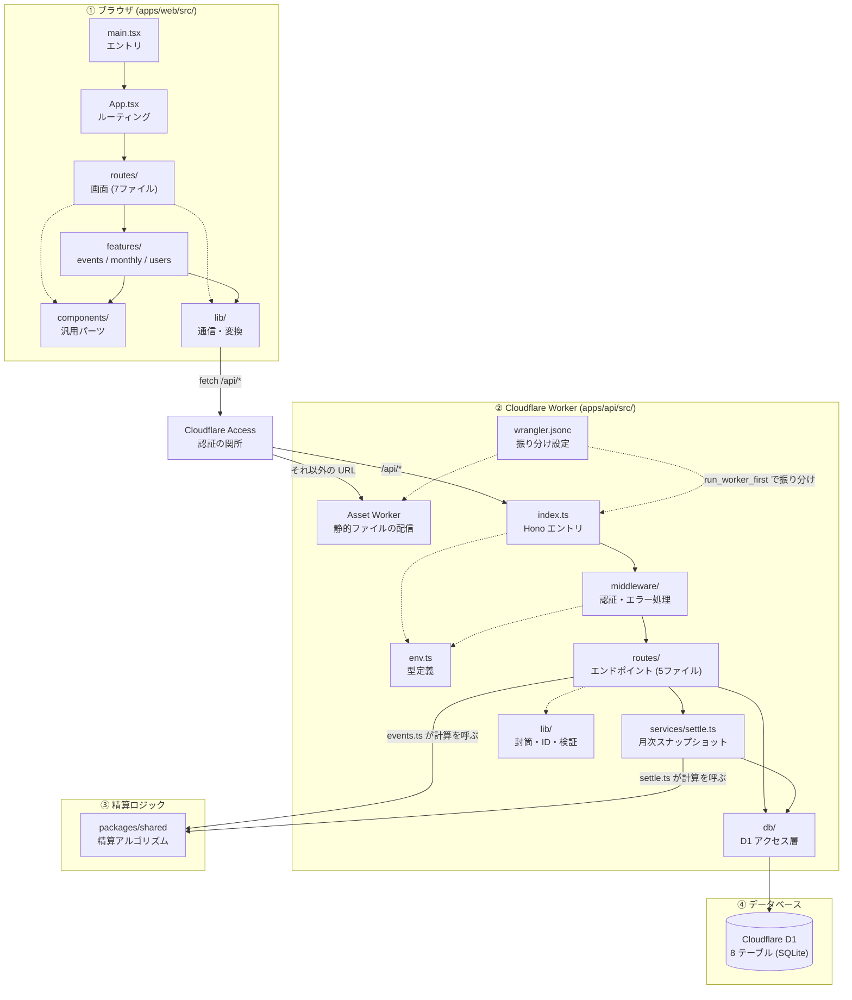

# 割り勘 (warikan) — 全体構成図

> [architecture-overview.html](architecture-overview.html) の Markdown 版（GitHub 上で読むためのもの）。HTML 版は枠をクリックすると説明が出る対話式の図で、こちらは同じ内容を図と節に展開している。

どのプログラムが・どこで動き・何をしていて・どれと繋がっているかを1枚の図にした。
もっと詳しく知りたくなったら、ファイル一覧は [技術構成ドキュメント](tech-stack.md)、動く順番は [プログラムの動作順番](program-flow.md) へ。

| 区分 | 場所 | 内容 |
|---|---|---|
| ブラウザ | `apps/web/src/` | React の SPA |
| Access | — | Cloudflare の認証の関所 |
| Worker | `apps/api/src/` | Hono の API |
| shared | `packages/shared/src/` | 精算ロジック |
| D1 | Cloudflare D1 | データベース |

## 図

実線 = データや処理が実際に流れる向き。破線 = 型定義など補助的な参照。

## 各プログラムの説明

### ① ブラウザ

#### main.tsx

`apps/web/src/main.tsx`

アプリの本当の入口。QueryClient を作り、React を `#root` にマウントする。ここが走るのは最初の1回だけで、以降の画面遷移では再実行されない。

- `QueryClient` — staleTime: 0（金額を古いまま見せない）、retry: 1
- `StrictMode > QueryClientProvider > BrowserRouter > App` — この順で包んで描画する

**つながり:** → [App.tsx](#app-tsx)（React ツリーをレンダリングする）

詳しく: [初回アクセスの流れを見る](program-flow.md#boot)

#### App.tsx

`apps/web/src/App.tsx`

react-router のルート定義。現在の URL に応じて routes/ の画面を1つ選ぶ。単発イベント作成ウィザードの下書き状態を `useReducer` で保持しており、旧 Flask 版が Cookie に頼っていた依存を無くしている。

**つながり:** → [routes/](#routes-web)（URL に応じて画面を1つ選ぶ）

詳しく: [URL 振り分けの詳細を見る](program-flow.md#boot)

#### routes/（web）

`apps/web/src/routes/`

1画面 = 1ファイル。7つの画面コンポーネント。隣に同名の `.test.tsx` を置く。

- `Home.tsx` — トップ。今月の合計と単発イベント履歴
- `MonthlyRecord.tsx` — 月次の支出記録 (`/monthly/:ym`)
- `MonthlyResult.tsx` — 月次の精算結果 (`/monthly/:ym/result`)
- `EventNew.tsx / EventInput.tsx` — 単発ウィザードの1・2画面目
- `EventDetail.tsx` — 単発イベントの詳細と送金チェック
- `Settings.tsx` — 表示名の編集

**つながり:**
- → [features/](#features)（機能コンポーネントを呼ぶ）
- → [components/](#components)（汎用パーツを直接使う画面もある）
- → [lib/ (web)](#lib-web)（書式変換などを直接呼ぶ画面もある）

詳しく: [各ファイルの一覧を見る](tech-stack.md#structure)

#### features/

`apps/web/src/features/`

機能ドメイン単位のフォルダ。UI コンポーネントと TanStack Query の `queries.ts`（useQuery / useMutation）をセットで置く。

- `events/` — SimpleInput / ItemsInput / wizardReducer / queries
- `monthly/` — ExpenseForm / ExpenseList / ResultView / queries
- `users/` — UserNameRow / queries

**つながり:**
- → [components/](#components)（汎用パーツを組み合わせる）
- → [lib/ (web)](#lib-web)（queries.ts が apiGet / apiSend を呼ぶ）

詳しく: [各ファイルの一覧を見る](tech-stack.md#structure)

#### components/

`apps/web/src/components/`

特定の機能ドメインを持たない、画面全体で使い回す汎用パーツ。

- `Button.tsx / Card.tsx` — 共通のボタン・カード
- `Toggle.tsx` — 2〜3択の切り替え（支払者選択など）。プルダウンより速い
- `AmountInput.tsx` — 金額入力。整数のみ、負値・小数を弾く
- `ErrorBanner.tsx` — ApiError を人が読めるメッセージに変換して表示

#### lib/（web）

`apps/web/src/lib/`

サーバー通信と共通ユーティリティ。画面の中で実際に fetch を呼ぶのはここだけ。

- `api.ts` — fetch ラッパ。`{ok,data}` / `{ok,error}` の封筒を剥がし、失敗は ApiError にする
- `queryKeys.ts` — TanStack Query のキーの唯一の出所。invalidate 漏れを防ぐ
- `types.ts` — API レスポンスの型
- `format.ts / ym.ts / limits.ts` — 金額・日付の整形、年月変換、入力上限の定数

**つながり:** → [Cloudflare Access](#access)（`fetch("/api/...")` でリクエストを送る）

詳しく: [通信の往復を追う](program-flow.md#boot)

### 関所

#### Cloudflare Access

（Cloudflare の設定。アプリのコードではない）

`warikan.y-kakeibo.workers.dev` というドメイン全体を保護する認証の関所。許可された2件のメールだけを通し、通過したリクエストに署名付き JWT（`Cf-Access-Jwt-Assertion`）を自動で付与する。未ログインならここでログイン画面が出る。

**つながり:**
- → [Asset Worker](#asset-worker)（`/api/*` 以外はそのまま素通し）
- → [index.ts](#index-ts)（`/api/*` は JWT 検証つきで Worker へ）

詳しく: [関所を通る流れを見る](program-flow.md#boot)

### ② Cloudflare Worker

#### wrangler.jsonc

`apps/api/wrangler.jsonc`

Worker の設定ファイル。`assets.run_worker_first: ["/api/*"]` が「`/api/*` は Hono が先に処理し、それ以外は Asset Worker が返す」という振り分けを決める。この1行が無いと静的ページの配信が `/api/*` まで飲み込んでしまう。

**つながり:**
- → [index.ts](#index-ts)（run_worker_first でこの振り分けを設定）
- → [Asset Worker](#asset-worker)（同上）

詳しく: [リクエストの経路を見る](tech-stack.md#flow)

#### Asset Worker

（Cloudflare 組み込み機能。アプリのコードではない）

`apps/web/dist`（Vite のビルド成果物）を配信する Cloudflare 側の仕組み。`not_found_handling: "single-page-application"` の指定により、`/monthly/2026-08` のようなアプリ内 URL を直接開いても同じ `index.html` を返す。

#### index.ts

`apps/api/src/index.ts`

Hono アプリのエントリ。登録順がそのまま実行順になる: エラーハンドラを先に張る → `/api/health` だけ認証なしで通す → 以降すべてに認証ミドルウェアを噛ませる → 各ルータをマウント。

**つながり:** → [middleware/](#middleware)（登録順にミドルウェアを通す）

詳しく: [登録順のコードを見る](program-flow.md#boot)

#### env.ts

`apps/api/src/env.ts`

Bindings（D1, `ACCESS_*` などの環境変数）と `c.var.user` の型定義。実行時の値そのものではなく、Worker 全体で使う型だけを提供する。

#### middleware/

`apps/api/src/middleware/`

全リクエスト共通の前処理。ハンドラより先に必ず通る。

- `auth.ts` — JWT を JWKS で署名検証し、メールを取り出して users 行を解決（accessAuth）
- `errors.ts` — 例外を共通エラーエンベロープ `{ ok:false, error }` へ変換

**つながり:** → [routes/ (API)](#routes-api)（認証済みリクエストをルータへ渡す）

詳しく: [認証処理の詳細を見る](program-flow.md#boot)

#### routes/（API）

`apps/api/src/routes/`

HTTP の入出力と zod によるバリデーションだけを持つ層。SQL は直接書かない。

- `me.ts` — GET/PATCH `/api/me`
- `users.ts` — GET `/api/users`, PATCH `/api/users/:id`
- `categories.ts` — GET `/api/categories`
- `monthly.ts` — 月次の期間・支出・締め・結果（8本）
- `events.ts` — 単発イベントの CRUD と送金フラグ（5本）

**つながり:**
- → [db/](#db-api)（D1 の読み書き）
- → [services/settle.ts](#services-settle)（月次の締め処理を任せる）
- → [packages/shared](#shared)（単発イベント作成時に精算を計算 (events.ts)）
- → [lib/ (API)](#lib-api)（共通エンベロープで応答する）

詳しく: [全エンドポイント一覧を見る](tech-stack.md#endpoints)

#### db/

`apps/api/src/db/`

D1 への SQL を閉じ込める層。ルータやサービスから呼ばれ、SQL を書くのはここだけ。原子性が要る箇所は `env.DB.batch([...])` を使う（D1 は対話的トランザクション非対応）。

- `rows.ts` — テーブル行の型（`*Row`）。DB スキーマとの唯一の接点
- `users.ts / categories.ts` — ユーザーとカテゴリの読み書き
- `monthly.ts` — 期間・支出の読み書き。支出の増減時に `is_dirty` を同じ batch で立てる
- `events.ts` — イベント・メンバー・品目・送金をまとめて batch で保存

**つながり:** → [Cloudflare D1](#d1)（SQL を実行する）

詳しく: [テーブル構造を見る](tech-stack.md#database)

#### services/settle.ts

`apps/api/src/services/settle.ts`

月次の精算スナップショットを組み立てる、db 層と shared の計算結果をまたぐ業務ロジック。ユーザー・支出・カテゴリを取得し、精算を計算し、カテゴリ別内訳を合成し、旧スナップショットから isPaid を引き継ぐ。

**つながり:**
- → [db/](#db-api)（支出・ユーザー・カテゴリを読む）
- → [packages/shared](#shared)（`calculateSettlement` を呼ぶ）

詳しく: [月次の締め処理を追う](program-flow.md#monthly)

#### lib/（API）

`apps/api/src/lib/`

外部に依存しない小物関数。

- `response.ts` — `ok()` / `fail()` — 共通エンベロープの生成
- `ids.ts` — `newId()`（crypto.randomUUID）と `nowIso()`
- `ym.ts` — `"2026-08"` ↔ `{year,month}` の相互変換と検証
- `displayName.ts` — 表示名の正規化（見えない文字を除去）とバリデーション

### ③ 精算ロジック

#### packages/shared

`packages/shared/src/`

DB にも HTTP にも依存しない純粋な計算層。API の `routes/events.ts` と `services/settle.ts` の両方から import される。同じ入力なら必ず同じ出力を返すので単体でテストしやすい。

- `settlement.ts` — `computeShares`（負担額と端数配分） / `calculateSettlement`（貪欲マッチングで送金リストを作る） / `compareStr`（ロケール非依存の文字列比較）
- `types.ts` — Participant / Share / Transfer / SettlementResult
- `index.ts` — 公開 API の再エクスポート

詳しく: [精算アルゴリズムの手順を見る](program-flow.md#algo)

### ④ データベース

#### Cloudflare D1

SQLite 方言。`apps/api/migrations/*.sql` で定義

8テーブル: `users`（2名） / `categories`（支出カテゴリ） / `monthly_periods`（月次の期間と締め状態） / `monthly_expenses`（月次の個別支出） / `events`（単発イベント） / `event_members` / `event_items` / `event_settlements`。

詳しく: [テーブル定義を見る](tech-stack.md#database)

---

割り勘 (warikan) — 全体構成図
関連: [技術構成ドキュメント](tech-stack.md)（ファイル一覧・依存関係の詳細）、[プログラムの動作順番](program-flow.md)（処理が動く順を追った説明）、`CLAUDE.md`
